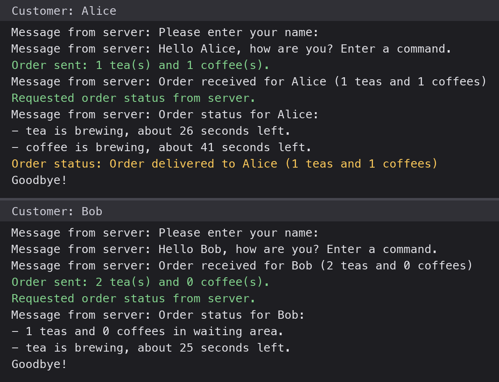
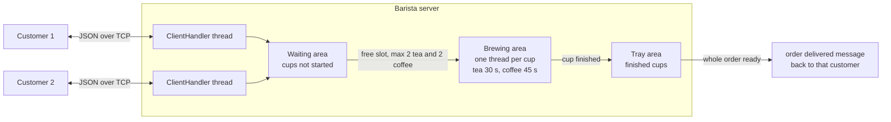
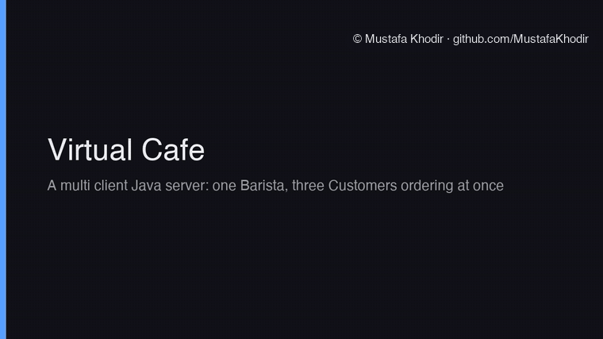

# Virtual Cafe: a Multi Client Java Server

A cafe simulation in Java where one Barista server takes drink orders from any number of Customer clients at the same time. Customers connect over TCP, type orders in plain English, and get told when their drinks are ready. The barista can only brew two teas and two coffees at once, so orders queue up and get worked through in the order they arrived.



## What it does

- The Barista server listens on port 8080 and gives every customer that connects their own thread.
- A customer gives their name, then types things like `order 2 teas and 1 coffee`, `order status` or `exit`.
- Every order moves through three areas on the server: the waiting area for cups not started yet, the brewing area for cups being made, and the tray area for finished cups waiting on the rest of the order.
- The barista brews at most 2 teas and 2 coffees at any one time. A tea takes 30 seconds and a coffee 45 seconds, simulated with a sleep on a thread per cup.
- When every cup in an order is on the tray the customer gets an "order delivered" message, which arrives on its own without them asking for it.
- `order status` tells the customer how many of their cups are in each area and roughly how long the brewing ones have left.
- If a customer leaves before their order is done, anything still waiting is dropped, and any cups already made for them go to the next customer who wants that drink. Cups nobody wants are discarded.
- The server prints the state of the cafe to its terminal after every change: how many customers are in, how many are waiting on an order, and how many cups are in each area.


## My role

Solo project. I designed the protocol, wrote the server and the client, and worked out the concurrency so the customer threads and the brewing threads could share the cafe state safely.

## How it works

### Talking to the server

Everything on the wire is one JSON object per line, built with Gson. The customer turns what you type into one of these:

| You type | Sent to the server |
| --- | --- |
| `order 2 teas and 1 coffee` | `{"type":"order","tea":2,"coffee":1}` |
| `order status` | `{"type":"status"}` |
| `exit` | `{"type":"exit"}` |

The server answers with `{"type":"message","content":"..."}` for normal replies and `{"type":"order-update","status":"..."}` when an order is delivered. The customer has a second thread that does nothing but read from the socket, so a delivery message can turn up while you are halfway through typing something else.

### How an order moves



### Two customers at once

This is from a real run with two customers connected at the same time. Alice ordered a tea and a coffee, and a moment later Bob ordered two teas. The barista had one tea slot left, so Bob's second tea waited until Alice's tea was done. Server output, trimmed to the key lines:

```text
[Request from Alice] order
Order for 1 tea and 1 coffee from Alice
Started brewing a tea for Alice
Started brewing a coffee for Alice
[Request from Bob] order
Order for 2 tea and 0 coffee from Bob
Started brewing a tea for Bob
  cups in waiting area: 1
  cups in brewing area: 3 (2 tea, 1 coffee)
Done brewing a tea for Alice, took 30000 millis
Started brewing a tea for Bob
Done brewing a coffee for Alice, took 45000 millis
Delivered order to Alice
```

Alice's side of the same run:

```text
Order sent: 1 tea(s) and 1 coffee(s).
Message from server: Order received for Alice (1 teas and 1 coffees)
Message from server: Order status for Alice:
- tea is brewing, about 26 seconds left.
- coffee is brewing, about 41 seconds left.
Order status: Order delivered to Alice (1 teas and 1 coffees)
```


The full log from both customers and the server is in `media/two-customers-session.txt`.

### Inside the barista

Each customer gets a ClientHandler on its own thread. The three areas are shared between all of those threads and the brewing threads, so every change to them happens inside one lock. That was the main thing I had to get right. Without it two threads could both grab the last free brewing slot, or a cup could finish for a customer at the exact moment they were leaving.

Starting an order works like this:

1. The order goes into the waiting area. If the customer already has cups waiting, the new cups join that order instead of starting a second one.
2. The barista walks the waiting area from the oldest order and moves cups into the brewing area while there is a free slot for that type. Each cup gets its own thread that sleeps for the brew time.
3. When a cup finishes, it goes on that customer's tray, the freed slot is handed to the next waiting cup straight away, and the barista checks whether any customer now has nothing left waiting or brewing. If so, their tray is delivered in one message.

Leaving is handled in the same lock. The customer's waiting cups are removed, their tray is offered cup by cup to anyone still waiting for that drink, and any cup still brewing for them gets the same treatment when it finishes.

### Next steps

Next I would add customer authentication, write the server log to a JSON file, and handle SIGTERM so the server shuts down cleanly.


## Source code

The source code is private and available on request. Contact me at mkhodir77@gmail.com.

## What's in this repo

- `media/` the terminal image and the full log of a real two customer run.
- `media/demo/` the demo recordings, GIFs to watch here and one MP4 with captions.

## Demo

A real run of the server with three customers ordering at the same time. Bob's second tea waits for a free slot and starts brewing the moment Alice's tea is done. The long brewing waits are cut short in the recording.



The full run with captions:

https://github.com/user-attachments/assets/e4a356e3-ee0e-40c6-98bd-9cac5427a22a

The same video is in the repo as [virtual-cafe-demo.mp4](media/demo/virtual-cafe-demo.mp4) (38 s). Background music in the MP4 is a jazzy cafe track with electric piano and walking bass, synthesised from scratch for these demos and released as CC0.

The full project report is available on request.

Copyright 2026 Mustafa Khodir. All rights reserved.
